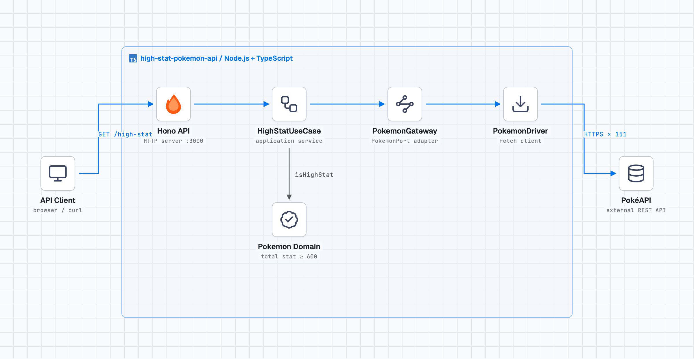

# High-Stat-Pokemon-API

## 概要

種族値の合計が600以上の第一世代のポケモンを返すAPIです。
クリーンアーキテクチャに基づいて設計しています。

## 使用技術

- Hono
- TypeScript
- Vitest
- PokeAPI

## アーキテクチャ



`GET /high-stat` は Hono から `HighStatUseCase` を実行し、PokéAPI のID 1–151のデータを取得します。ドメイン層で種族値合計が600以上のポケモンを判定し、ID・名前・合計値を返します。

## ディレクトリ構成

```
src/
├── __tests__/
│   ├── HighStatUsecase.test.ts
│   └── Pokemon.test.ts
├── domain/
│   └── Pokemon.ts
├── driver/
│   └── pokemonDriver.ts
├── gateway/
│   └── pokemonGateway.ts
├── usecase/
│   ├── port/
│   │   └── PokemonPort.ts
│   └── HighStatUsecase.ts
├── container.ts
└── index.ts
```

## セットアップ

### 1. リポジトリをクローン

```bash
git clone https://github.com/Seripro/high-stat-pokemon-api.git
cd high-stat-pokemon-api
```

### 2. 依存関係のインストール

```bash
npm install
```

## 起動方法

```bash
npm run dev
```

## エンドポイント

**リクエスト**

```bash
curl http://localhost:3000/high-stat
```

**レスポンス**

```json
[
  {
    "id": 149,
    "name": "dragonite",
    "total_stat": 600
  },
  {
    "id": 150,
    "name": "mewtwo",
    "total_stat": 680
  },
  {
    "id": 151,
    "name": "mew",
    "total_stat": 600
  }
]
```

## その他コマンド一覧

```bash
# ビルド
npm run build
```

```bash
# テスト
npm run test
```
